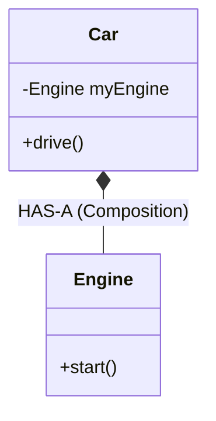
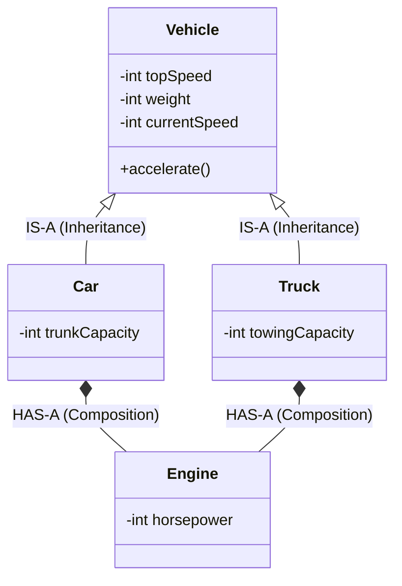
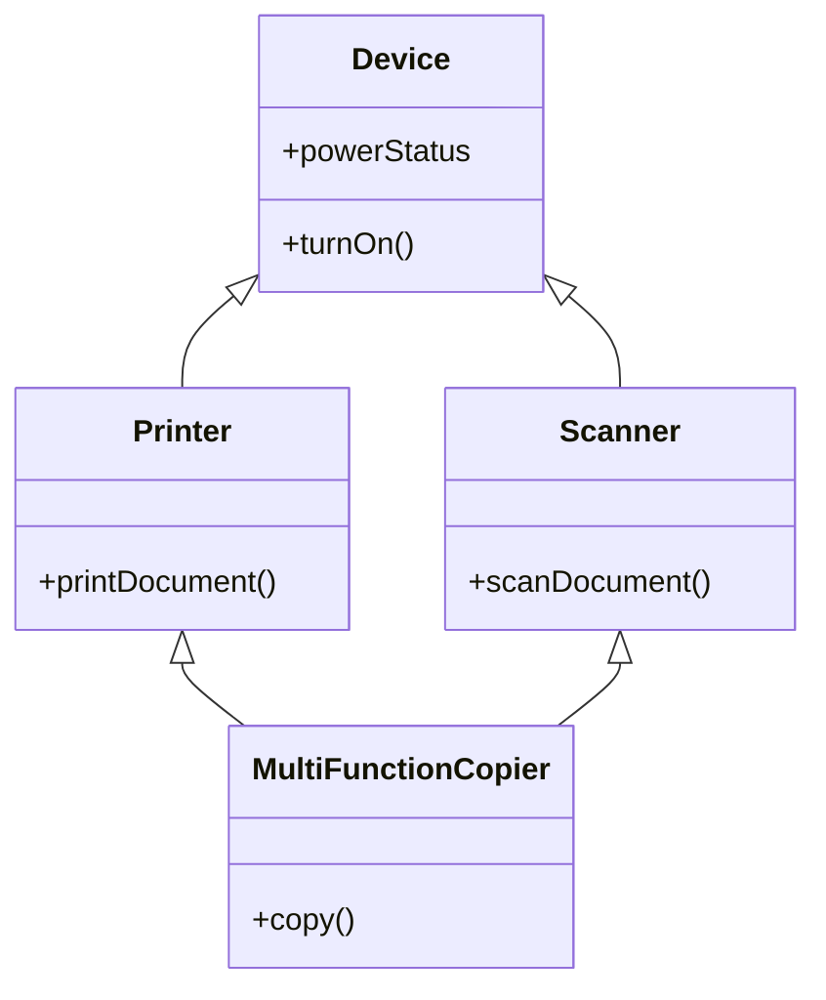
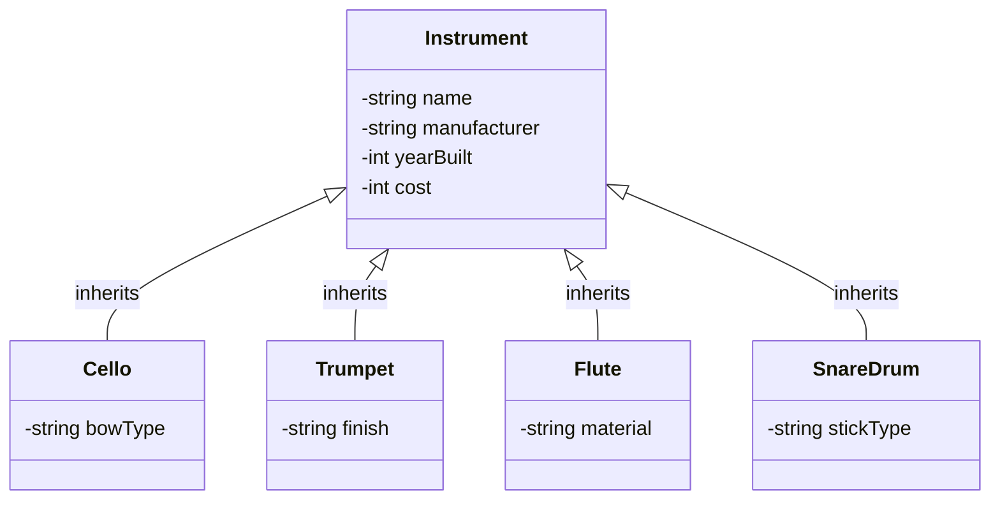

# Inheritance and Polymorphism in C++

## 1. Building Complexity: Composition First

Before diving into inheritance, it is important to understand how we traditionally build complex objects in C++ using **composition**.

Composition is the practice of building a complex class by combining simpler objects as member variables. For instance, a `Car` object might contain an `Engine` object and four `Wheel` objects.



Here is what that **HAS-A** relationship looks like in actual C++ syntax. Notice how the `Car` class creates an instance of `Engine` as a private member variable to do its job:

```cpp
#include <iostream>
using namespace std;

class Engine 
{
    public:
        void start() 
        {
            cout << "Engine is running.\n";
        }
};

class Car 
{
    private:
        // Composition: A Car HAS-A Engine
        Engine myEngine; 

    public:
        void drive() 
        {
            // Using the composed object's functionality
            myEngine.start(); 
            cout << "Car is driving forward.\n";
        }
};
```

Composition solves the problem of *assembly* (putting parts together to make a whole). But what happens when we do not want to just assemble parts, but instead need to create a *specialized version* of an existing concept? That is where we cross the bridge from composition to inheritance.

## 2. What is Inheritance? (And Why Do We Use It?)

In Object-Oriented Programming, **inheritance** is a mechanism that allows a new class to acquire the properties and behaviors of an existing class.

### The Core Goals of Inheritance

* **Code Reusability:** Write common attributes and methods once in a base class rather than copying and pasting boilerplate code into every new class.

* **Extensibility:** Take a general concept and specialize it by adding new variables and functions without altering the original working code.

* **Logical Hierarchy:** Organize code to mirror real-world classifications and relationships.

## 3. The IS-A vs. HAS-A Relationship

Building on our introduction to composition, we must always ask: *How do these objects relate to one another?* We categorize software design relationships into two main buckets: **IS-A** and **HAS-A**.

* **IS-A (Inheritance):** Represents a relationship of specialization. If Class B **IS-A** Class A, it means Class B is a specific version of Class A. It automatically receives Class A's attributes and behaviors, and then adds its own.

* **HAS-A (Composition):** Represents ownership or a part-whole relationship. If Class B **HAS-A** Class A, it means Class B contains an instance of Class A as a member variable to do its job.

### Applying IS-A to Vehicles

If we want our program to represent different types of vehicles, we do not want to write the same core variables for every single type. Instead, we can create a `Vehicle` base class that holds shared data like `topSpeed`, `weight`, and `currentSpeed`, along with shared behaviors like `accelerate()`.

A `Car` **IS-A** `Vehicle`. A `Truck` **IS-A** `Vehicle`. Because of this inheritance, both `Car` and `Truck` logically contain the foundational data from `Vehicle`, and we only need to write code for their specialized features (like `trunkCapacity` for the car, and `towingCapacity` for the truck).

Conversely, a `Car` is not an engine. It uses an engine. Therefore, the `Car` **HAS-A** `Engine`, meaning we represent that by giving `Car` a member variable of type `Engine`.



## 4. Core Terminology

Before mapping these concepts to C++ syntax, we need to establish a shared vocabulary:

* **Base Class (Parent / Superclass):** The original, general class whose attributes and methods are being inherited (e.g., `Vehicle`).

* **Derived Class (Child / Subclass):** The new, specialized class that inherits from the base class and adds its own unique features (e.g., `Truck`).

* **Specialization:** The process of extending a general base class to create a more specific derived class.

* **Generalization:** Extracting shared traits from multiple specialized classes and placing them into a common base class.

* **Access Specifiers:** Keywords (`public`, `private`, `protected`) that control which parts of a program can see and modify class members.

## 5. The Private Data Barrier

In C++, inheriting from a class means the derived class object contains the base class's data in memory. However, **inheriting data does not mean having direct access to it**.

In our `Vehicle` example, if the member variables (`topSpeed` and `weight`) are marked `private`, **only** methods inside the `Vehicle` class itself can read or modify them directly. Even a child class like `Car` is locked out.

### How Derived Classes Interact with Private Base Data

```cpp
// Inside a Car method:
void Car::updateDetails() 
{
    // COMPILER ERROR! 'topSpeed' and 'weight' are private.
    // topSpeed = 150; 
    // weight = 3000;

    // CORRECT: Use the public mutators (setters) inherited.
    setTopSpeed(150);
    setWeight(3000);
}
```

To read or change base class data, derived classes must go through the `public` interface—using getters like `getTopSpeed()` and setters like `setTopSpeed()`. This preserves **encapsulation** and ensures any validation logic (like `isValidSpeed()` inside `Vehicle`) cannot be bypassed by child classes.

## 6. The `protected` Access Modifier (The VIP Pass)

What if a base class designer *wants* child classes to have direct access to certain variables or helper methods, while still hiding them from the outside world (like `main.cpp`)? C++ provides a middle-ground access specifier: **`protected`**.

Think of `protected` as a **VIP Pass** for family members:

* **`private`:** Locked in a safe. Accessible *only* within the class itself. Neither `main.cpp` nor derived classes can touch it directly.

* **`protected`:** A VIP pass for derived classes. Accessible within the class itself **AND** within any derived classes, while remaining completely hidden from outside code like `main.cpp`.

* **`public`:** Open to the general public. Accessible from anywhere.

### Comparing `private` vs. `protected` in Action

If we hypothetically changed `topSpeed` in `Vehicle` from `private` to `protected`, direct access would behave differently depending on where the code lives:

```cpp
class Vehicle 
{
    protected:
        int topSpeed; // Now has a VIP pass for child classes
    private:
        int weight;   // Still strictly locked to Vehicle only
};

// 1. Inside a Derived Class (Car.cpp)
void Car::setup() 
{
    // ALLOWED! Derived classes can access 'protected' members.
    topSpeed = 120; 
    
    // COMPILER ERROR! 'weight' is still 'private'.
    // weight = 4000; 
}

// 2. Inside Outside Code (main.cpp)
int main() 
{
    Car myCar;
    // COMPILER ERROR! 'protected' is hidden from main().
    // myCar.topSpeed = 120; 
    
    // COMPILER ERROR! 'private' is hidden from main().
    // myCar.weight = 4000;  
}
```

### Architectural Design Choices & Modern C++ Commentary

Choosing between `private`, `protected`, and `public` is an intentional architectural decision that balances convenience against safety:

* **When `protected` is useful:** It is great for internal helper methods (like a `calculateBaseEmissions()` function) that child classes need to use to build their own behavior, but that outside users in `main()` should never call directly.

* **Modern C++ Guidance on Data Members:** While `protected` member variables are completely valid C++, modern C++ Core Guidelines generally advise keeping **data members** `private` and exposing `protected` getters/setters if derived classes need special access.

* **Why?** If a base class makes data `protected`, any derived class (even one written years later by another developer) can mutate that data directly, potentially bypassing validation rules (like `isValidSpeed()`) or breaking invariants the base class relies on. Keeping data `private` forces everyone—even child classes—to respect the class's data integrity rules.

## 7. Types of Inheritance (Inheritance Access Specifiers)

When declaring that a class inherits from a base class, you must provide an inheritance access specifier. This controls how the inherited members are exposed in the newly derived class.

### 1. Public Inheritance

```cpp
class Derived : public Base {};
```

* **What it does:** `public` members of the base class remain `public` in the derived class, and `protected` members remain `protected`.

* **Why use it:** This represents a true **IS-A** relationship (e.g., a `Car` IS-A `Vehicle`). It ensures that outside code can still interact with the base class methods through the child object.

* **Modern C++ Status:** This is the standard, most common form of inheritance and is required for polymorphism.

### 2. Protected Inheritance

```cpp
class Derived : protected Base {};
```

* **What it does:** Both `public` and `protected` members of the base class become **`protected`** in the derived class.

* **Why use it:** Used when you want to utilize the base class's code internally, and allow further subclasses of `Derived` to use it, but you want to completely hide the base class interface from outside code like `main.cpp`.

* **Modern C++ Status:** Very rarely used. It is generally avoided in favor of building better interfaces or using composition.

### 3. Private Inheritance

```cpp
class Derived : private Base {};
```

* **What it does:** Both `public` and `protected` members of the base class become **`private`** in the derived class. Everything is completely hidden from the outside world *and* from any further subclasses derived from this one.

* **Why use it:** This represents an "implemented-in-terms-of" relationship. You are merely recycling the base class's logic internally, but not creating a logical IS-A hierarchy.

* **Modern C++ Status:** Generally avoided. Modern C++ heavily favors using **Composition (HAS-A)** instead of private inheritance to achieve this exact same goal, as composition creates looser coupling and a cleaner architecture.

## 8. Multiple Inheritance and the Diamond Problem

Unlike some other languages (like Java or C#), C++ allows a class to inherit from *more than one* base class at a time. This is known as **multiple inheritance**. While powerful, it introduces a notorious architectural challenge known as the **Diamond Problem**.

Imagine we have a base class `Device`. From `Device`, we derive two classes: `Printer` and `Scanner`. Both inherit properties like `powerStatus` from `Device`. Now, we want to create a `MultiFunctionCopier` that acts as both a printer and a scanner, so it inherits from both `Printer` and `Scanner`.



### The Ambiguity of the Diamond

Because of this diamond shape, `MultiFunctionCopier` inherits `Device` *twice*—once through `Printer` and once through `Scanner`.

Here is what the C++ class declaration looks like to inherit from both, using commas to separate each base class:

```cpp
// The MultiFunctionCopier uses Multiple Inheritance
class MultiFunctionCopier : public Printer, public Scanner 
{
    // ...
};
```

If you call `myCopier.turnOn()`, the C++ compiler gets confused and throws an error: *Which* `turnOn()` should it use? The one inherited from the `Printer`'s copy of `Device`, or the one inherited from the `Scanner`'s copy of `Device`?

### The Fix: Virtual Inheritance

C++ solves this using **virtual inheritance**. By adding the `virtual` keyword when `Printer` and `Scanner` inherit from `Device`, C++ guarantees that only a single, shared instance of the `Device` base class is inherited by the `MultiFunctionCopier`.

```cpp
// 1. Printer and Scanner virtually inherit from Device
class Printer : virtual public Device { /* ... */ };
class Scanner : virtual public Device { /* ... */ };

// 2. MultiFunctionCopier gets ONE shared Device instance!
class MultiFunctionCopier : public Printer, public Scanner 
{ 
    /* ... */ 
};
```

## 9. The `final` Keyword

Introduced in modern C++, the `final` keyword is an excellent tool for enforcing architectural boundaries. It allows you to strictly prevent further inheritance or overriding.

### 1. Final Classes

If you have built a specialized class and want to guarantee no one can ever inherit from it, add `final` directly after the class name.

```cpp
// No one can ever inherit from RaceCar
class RaceCar final : public Car 
{
    // ...
};

// COMPILER ERROR! Cannot derive from a final class.
// class FormulaOne : public RaceCar {}; 
```

### 2. Final Virtual Functions

If you want to allow a class to be inherited, but want to lock down a *specific* function so it cannot be overridden any further down the chain, use `final` on the method:

```cpp
class Car : public Vehicle 
{
    public:
        // Children of Car cannot override this!
        void accelerate() override final 
        {
            cout << "Car accelerating safely.\n";
        }
};
```

## 10. Additional Nuances: Object Slicing and Downcasting

When working heavily with inheritance, there are two major concepts and pitfalls you must be aware of regarding how C++ handles objects in memory.

### 1. Object Slicing

Polymorphism only works when you use **pointers** or **references**. If you attempt to pass a derived object by *value* to a function expecting a base class, C++ will literally slice off all the derived class's unique data to make it fit into the base class's memory footprint.

```cpp
// DANGER: Passing by value causes Object Slicing!
void testVehicle(Vehicle v) 
{
    // This will ALWAYS call Vehicle's accelerate, never Car's!
    v.accelerate(); 
}

int main() 
{
    Car myCar("Mustang");
    
    // As myCar is copied into the function parameter 'v', 
    // all of its "Car-ness" is completely sliced away.
    testVehicle(myCar); 
}
```

**The Fix:** Always pass polymorphic objects by pointer (`Vehicle*`) or reference (`const Vehicle&`).

### 2. Downcasting (`dynamic_cast`)

Normally, we "upcast"—treating a `Car` safely as a generic `Vehicle`. But sometimes, you have a generic `Vehicle` pointer and you need to access a function that *only* exists in the `Car` class (like `openTrunk()`).

To do this safely, we use `dynamic_cast`. It checks at runtime if the cast is actually valid. If the `Vehicle` pointer is actually pointing to a `Truck`, the cast to `Car` will fail and safely return a `nullptr`.

**Downcasting with Legacy Raw Pointers:**

```cpp
void inspectVehicle(Vehicle* vPtr) 
{
    // Attempt to cast the generic pointer into a Car pointer
    Car* carPtr = dynamic_cast<Car*>(vPtr);

    // Always check if the cast succeeded before using it!
    if (carPtr != nullptr) 
    {
        cout << "Safe to use Car-specific methods.\n";
    } 
    else 
    {
        cout << "Not a Car.\n";
    }
}
```

**Downcasting with Smart Pointers:**
If you are managing your memory properly with smart pointers (like `std::shared_ptr`), C++ provides a specialized casting function so you do not break the reference counting:

```cpp
#include <memory>

void inspectSmartVehicle(shared_ptr<Vehicle> vPtr) 
{
    // Use dynamic_pointer_cast for shared_ptrs
    shared_ptr<Car> carPtr = dynamic_pointer_cast<Car>(vPtr);

    if (carPtr) 
    {
        cout << "Successfully casted to a Car!\n";
    }
}
```

*(Note: `std::unique_ptr` cannot be downcasted easily because it enforces exclusive ownership, meaning you cannot create a second pointer to the same object. If downcasting is required, you usually extract the raw observing pointer using `.get()` and cast that instead).*

## 11. Introduction to Polymorphism

Inheritance provides the foundation for one of the most powerful concepts in Object-Oriented Programming: **Polymorphism**. The word means "many forms." In C++, it allows us to write general code that works with different, specialized types of objects.

Polymorphism comes in two primary flavors:

### 1. Compile-Time Polymorphism (Static)

This happens when the compiler knows exactly which function to call before the program even runs.

* **Function Overloading:** Having multiple functions with the same name but different parameters (e.g., `accelerate()` and `accelerate(int targetSpeed)`).

* **Constructor Overloading:** Providing different ways to initialize an object.

The compiler looks at the arguments you provide and permanently binds the call to the correct version of the function.

### 2. Runtime Polymorphism (Dynamic)

This is where inheritance shines. Runtime polymorphism allows a program to decide *while it is running* which version of a function to call based on the actual object type in memory, even if you are only looking at it through a base class pointer or reference.

If we have a `Vehicle*` pointer that is secretly pointing to a `Car` object, calling `accelerate()` will dynamically trigger the `Car`'s specific acceleration logic, not the generic `Vehicle`'s.

### C++ Syntax Requirements & Best Practices

To achieve runtime polymorphism safely, modern C++ requires a strict set of rules and highly encouraged keywords:

* **The `virtual` Keyword (Base Class):** Any function in the base class that you want child classes to override *must* be marked with the `virtual` keyword. This tells the compiler to look up the correct function at runtime.

* **The Virtual Destructor (Crucial!):** If a base class has *any* virtual functions, its destructor **must** be marked `virtual` (e.g., `virtual ~Vehicle() = default;`). Without this, if you delete a derived object through a base class pointer, the child's destructor won't run, causing severe memory leaks. (Note: Only use `= default` if your class doesn't manage raw pointers or custom resources directly).

* **The `override` Keyword (Derived Class):** When a child class provides its own version of a virtual function, you should suffix it with the `override` keyword. This acts as a compiler safety net against typos.

### 3. Abstract Base Classes and Pure Virtual Functions

Sometimes, a base class is *so* general that it doesn't make sense to ever instantiate it. You shouldn't be able to just build a generic "Vehicle" without specifying if it's a Car or a Truck.

We can force a class to become an **Abstract Base Class (ABC)** by assigning a virtual function `= 0`. This is called a **pure virtual function**. It means the base class provides no implementation, and every child class is *forced* to write their own version.

```cpp
class Vehicle 
{
    public:
        // The '= 0' makes this a pure virtual function.
        // Vehicle is now an Abstract Base Class!
        virtual void accelerate() = 0; 
};
```

## 12. C++ Polymorphism in Action: The `Vehicle` Fleet

Let's look at the exact C++ syntax for building out our `Vehicle` inheritance hierarchy. Notice how we use a standard vector of `unique_ptr`s to hold different derived objects side-by-side, treating them all as generic `Vehicle`s but achieving specialized behavior!

```cpp
#include <iostream>
#include <string>
#include <vector>
#include <memory>
using namespace std;

// ==========================================================
// Base Class (Parent)
// ==========================================================
class Vehicle 
{
    protected:
        // protected allows derived classes to access easily
        string name;
        int currentSpeed;

    public:
        // 'explicit' prevents accidental conversions 
        // from string directly to a Vehicle
        explicit Vehicle(string name) 
            : name(name), currentSpeed(0) {}

        // MANDATORY for polymorphic base classes!
        virtual ~Vehicle() = default;

        string getName() const { return name; }
        int getSpeed() const { return currentSpeed; }

        // The 'virtual' keyword enables runtime polymorphism
        virtual void accelerate() 
        {
            currentSpeed += 5;
            cout << name << " accelerates gently to " 
                 << currentSpeed << " mph.\n";
        }
};

// ==========================================================
// Derived Class 1: Car
// ==========================================================
class Car : public Vehicle 
{
    public:
        // Pass data up to the Vehicle constructor
        explicit Car(string name) : Vehicle(name) {}

        // 'override' guarantees a perfect signature match
        void accelerate() override 
        {
            currentSpeed += 15; 
            cout << name << " (Car) revs the engine up to " 
                 << currentSpeed << " mph!\n";
        }
};

// ==========================================================
// Derived Class 2: Truck
// ==========================================================
class Truck : public Vehicle 
{
    public:
        explicit Truck(string name) : Vehicle(name) {}

        void accelerate() override 
        {
            currentSpeed += 8;
            cout << name << " (Truck) rumbles heavily to " 
                 << currentSpeed << " mph.\n";
        }
};

// ==========================================================
// The Polymorphic Main Program
// ==========================================================
int main() 
{
    // A vector of smart pointers to the BASE class.
    // This list can hold ANY object that IS-A Vehicle!
    vector<unique_ptr<Vehicle>> fleet;

    // Pushing derived objects into the base class container
    fleet.push_back(make_unique<Car>("Mustang"));
    fleet.push_back(make_unique<Truck>("F-150"));
    fleet.push_back(make_unique<Vehicle>("Generic Golf Cart"));

    cout << "--- Commencing Fleet Acceleration ---\n";

    // Simulate 5 separate phases of acceleration
    for (int phase = 1; phase <= 5; ++phase) 
    {
        cout << "\n[ Phase " << phase << " ]\n";
        
        // Loop through the vehicles and accelerate them
        for (const auto& v : fleet) 
        {
            // Polymorphism at work: 
            // The program checks the actual object in memory
            // at runtime and calls the correct version!
            v->accelerate(); 
        }
    }

    // Smart pointers clean up memory automatically.
    // The virtual destructor ensures child destructors run!
    return 0;
}
```

## 13. Another Example: The Instrument Family Tree

To see another example of public inheritance beyond our vehicles, consider an `Instrument` base class. When we expand our base class into multiple specialized families, we create an inheritance hierarchy. Each derived class publicly inherits the core members from `Instrument` while maintaining its own distinct member variables.

