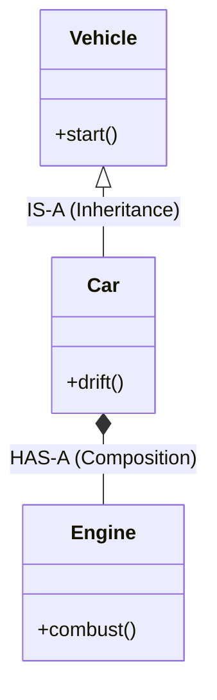
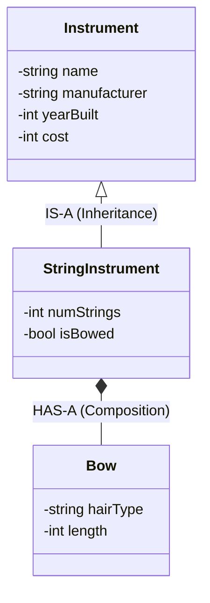
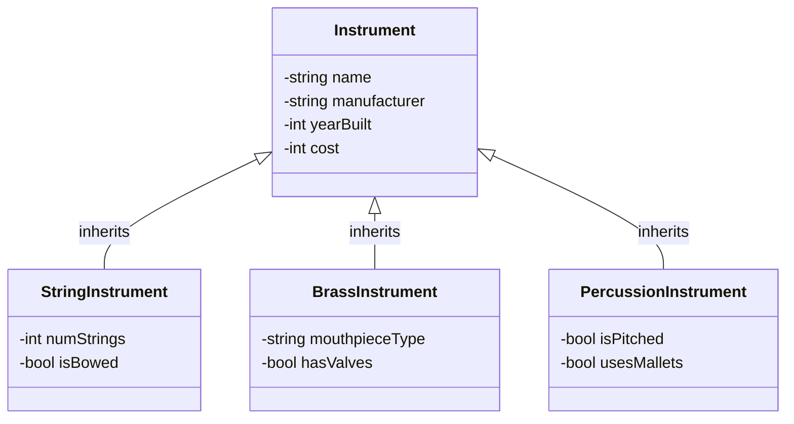

# Object-Oriented Inheritance & Access Control

## 1. What is Inheritance? (And Why Do We Use It?)
In Object-Oriented Programming (OOP), **inheritance** is a mechanism that allows a new class (the **derived** or **child** class) to acquire the properties and behaviors of an existing class (the **base** or **parent** class). 

### The Core Goals of Inheritance
*   **Code Reusability:** Write common attributes and methods once in a base class rather than copying and pasting boilerplate code into every new class.
*   **Extensibility:** Take a general concept and specialize it by adding new variables and functions without altering the original working code.
*   **Logical Hierarchy:** Organize code to mirror real-world classifications and relationships.

---

## 2. The IS-A vs. HAS-A Relationship
Before writing any inheritance code, we must ask: *How do these objects relate to one another?* We categorize software design relationships into two main buckets: **IS-A** and **HAS-A**.

*   **IS-A (Inheritance):** Represents a relationship of specialization. If Class B **IS-A** Class A, it means Class B is a specific version of Class A. It automatically receives Class A's attributes and behaviors, and then adds its own.
*   **HAS-A (Composition):** Represents ownership or a part-whole relationship. If Class B **HAS-A** Class A, it means Class B contains an instance of Class A as a member variable to do its job.



### Applying IS-A to the Instrument Class
When we look at our `Instrument` base class, it contains foundational data like `name`, `manufacturer`, `yearBuilt`, and `cost`[cite: 1]. If we want to represent a cello in our program, we do not want to rewrite all of that foundational code. 

Instead, we create a `StringInstrument` class and use the **IS-A** relationship. A `StringInstrument` **IS-A** `Instrument`. Because of this inheritance, the `StringInstrument` class logically contains the `name` and `cost` attributes defined in `instrument.h`[cite: 1], and we only need to write code for the new, specialized variables like `numStrings` and `isBowed`.

Conversely, a `StringInstrument` might use a `Bow` to produce sound. A `StringInstrument` is not a `Bow`, so inheritance is the wrong tool here. Instead, the `StringInstrument` **HAS-A** `Bow`, meaning we would represent that by giving `StringInstrument` a member variable of type `Bow`.



---

## 3. Visualizing the Family Tree
When we expand our `Instrument` base class into multiple specialized families, we create an inheritance hierarchy. Each derived class inherits the core members from `Instrument` while maintaining its own distinct member variables.



---

## 4. The Private Data Barrier
In C++, inheriting from a class means the derived class object contains the base class's data in memory. However, **inheriting data does not mean having direct access to it.**

In `instrument.h`, the member variables (`name`, `manufacturer`, `yearBuilt`, and `cost`) are marked `private`[cite: 1]. Because they are `private`, **only** methods inside the `Instrument` class itself can read or modify them directly[cite: 1]. Even a child class like `StringInstrument` is locked out.

### How Derived Classes Interact with Private Base Data
```cpp
// Inside a StringInstrument method:
void StringInstrument::updateDetails() {
    // COMPILER ERROR! 'name' and 'cost' are private in Instrument.
    // name = "Stradivarius"; 
    // cost = 1000000;

    // CORRECT: Use the public mutators (setters) inherited from Instrument.
    setName("Stradivarius");
    setCost(1000000);
}
```
To read or change base class data, derived classes must go through the `public` interface—using getters like `getName()` and setters like `setName()`[cite: 1]. This preserves **encapsulation** and ensures any validation logic (like `isValidYear()` inside `Instrument`) cannot be bypassed by child classes[cite: 1].

---

## 5. The `protected` Access Modifier
What if a base class designer *wants* child classes to have direct access to certain variables, while still hiding them from the outside world (like `main.cpp`)? C++ provides a middle-ground access specifier: **`protected`**.

*   **`private`:** Accessible *only* within the class itself.
*   **`protected`:** Accessible within the class itself **AND** within any derived classes, but still hidden from outside code.
*   **`public`:** Accessible from anywhere.

### Why `Instrument` Uses `private` Instead of `protected`
While `protected` might seem convenient, modern