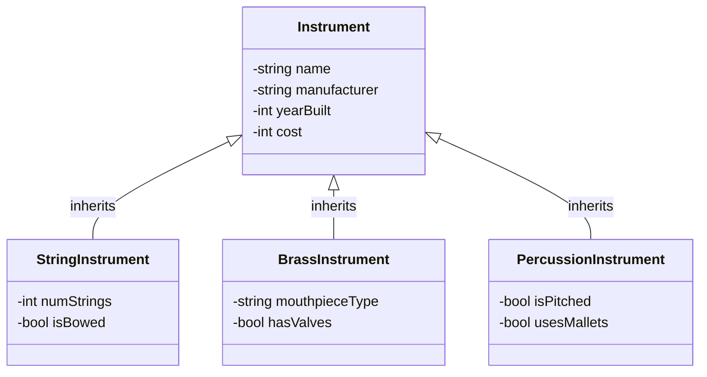

# Lecture 1: Inheritance & The Instrument Hierarchy

## 1. What is Inheritance?

Inheritance is a core concept in Object-Oriented Programming (OOP) that allows a new class to absorb the data and behaviors (variables and methods) of an existing class.

* **The "IS-A" Rule:** Inheritance models an "IS-A" relationship. A derived object *is a* base object.

* **One-Way Street:** A `StringInstrument` *is an* `Instrument`, but an `Instrument` is *not necessarily* a `StringInstrument`.

* **The DRY Principle:** "Don't Repeat Yourself." If multiple classes share the same attributes, put them in a base class!

## 2. The Point of Inheritance

Why do we bother creating hierarchies?

1. **Code Reuse:** We write the logic for tracking an instrument's name, manufacturer, and cost exactly once in the base class.

2. **Extensibility:** We can seamlessly add specific traits (like `numStrings` for a guitar) without altering the base code.

3. **Polymorphism:** Later, we can treat all specialized instruments uniformly as generic `Instrument` objects (e.g., storing them all in a single inventory list).

## 3. Visualizing the Family Tree

Here is a visual representation of how our base class extends into the three distinct derived classes.



**Text Representation:**

* **Instrument** (Base)

  * `StringInstrument` (Derived) - Adds: `numStrings`, `isBowed`

  * `BrassInstrument` (Derived) - Adds: `mouthpieceType`, `hasValves`

  * `PercussionInstrument` (Derived) - Adds: `isPitched`, `usesMallets`

## 4. Core Vocabulary

* **Base Class (Parent / Superclass):** The general foundation. In our case, `Instrument`.

* **Derived Class (Child / Subclass):** The specialized extension. In our case, `StringInstrument`, `BrassInstrument`, etc.

* **Access Modifiers:** Rules (`public`, `private`, `protected`) dictating what derived classes can see and touch.

## 5. The Private Data Barrier

A common misconception is that a derived class can directly access the private variables of its base class. **It cannot.**

In our `instrument.h` file, variables like `name` and `cost` are `private`. This means a `StringInstrument` cannot bypass the lock to change them directly.

**Incorrect (Will cause a compiler error):**

```cpp
// Inside StringInstrument methods...
void StringInstrument::doSomething() {
    name = "Fender Stratocaster"; // ERROR: 'name' is private in 'Instrument'
    cost = 1200;                  // ERROR: 'cost' is private in 'Instrument'
}
```

**Correct (Using the Public Interface):**
Derived classes must use the public getters and setters inherited from the base class.

```cpp
// Inside StringInstrument methods...
void StringInstrument::doSomething() {
    setName("Fender Stratocaster"); // SUCCESS!
    setCost(1200);                  // SUCCESS!
}
```

## 6. The Protected Access Modifier

If you *want* your derived classes to have direct access to base class variables, but still want to hide those variables from the rest of the outside world, you can use the `protected` access modifier.

Think of `protected` as a VIP pass:

* To `main.cpp` or any unrelated class, `protected` acts exactly like `private` (access denied).

* To a derived class (like `StringInstrument`), `protected` acts like `public` (access granted).

If we changed `instrument.h` to use `protected`:

```cpp
class Instrument {
    protected:
        string name = "";
        int cost = 0;
    // ... rest of class ...
};
```

Then, the derived class could do this legally:

```cpp
void StringInstrument::doSomething() {
    name = "Fender Stratocaster"; // SUCCESS: 'name' is protected
    cost = 1200;                  // SUCCESS: 'cost' is protected
}
```

*Note on Best Practices:* While `protected` is convenient, keeping variables `private` and forcing derived classes to use getters/setters (like we do in our `Instrument` class) is often preferred. It maintains strict encapsulation and ensures data validation logic in your setters is never bypassed!

## 7. Activity 01: Choose Your Family

For our first activity, you will build out a specialized instrument. Choose one of the following families to create your `.h` and `.cpp` files.

You must inherit `publicly` from `Instrument`.

**Option A: StringInstrument**

* Add: `int numStrings`, `bool isBowed`

**Option B: BrassInstrument**

* Add: `string mouthpieceType`, `bool hasValves`

**Option C: PercussionInstrument**

* Add: `bool isPitched`, `bool usesMallets`