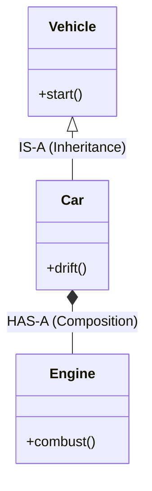
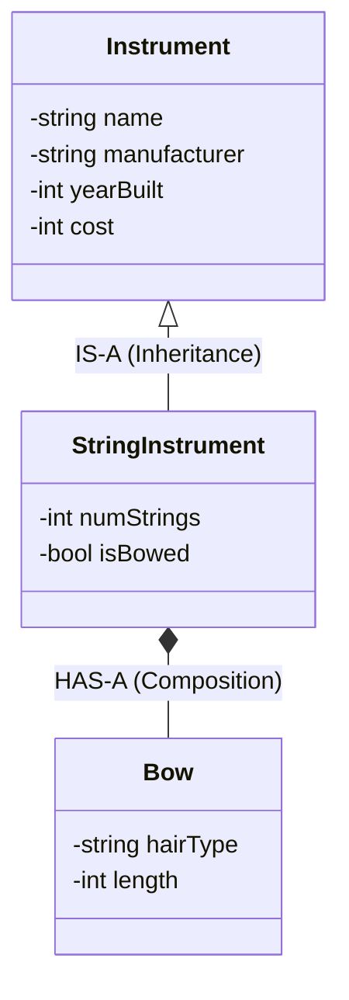
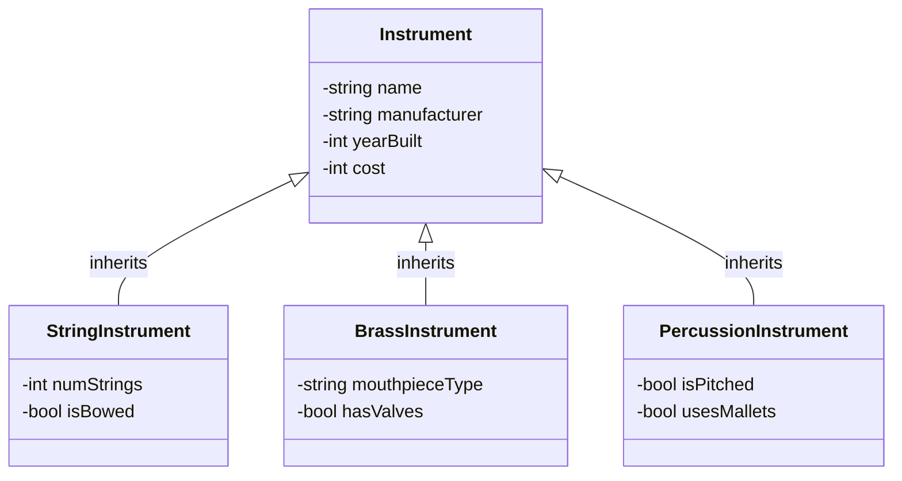

# Lecture 1: Object-Oriented Inheritance & Access Control

## 1. What is Inheritance? (And Why Do We Use It?)
In Object-Oriented Programming (OOP), **inheritance** is a mechanism that allows a new class to acquire the properties and behaviors of an existing class. 

### The Core Goals of Inheritance
*   **Code Reusability:** Write common attributes and methods once in a base class rather than copying and pasting boilerplate code into every new class.
*   **Extensibility:** Take a general concept and specialize it by adding new variables and functions without altering the original working code.
*   **Logical Hierarchy:** Organize code to mirror real-world classifications and relationships.

---

## 2. Core Terminology
Before diving into syntax, we need to establish a shared vocabulary:

*   **Base Class (Parent / Superclass):** The original, general class whose attributes and methods are being inherited (e.g., `Instrument`).
*   **Derived Class (Child / Subclass):** The new, specialized class that inherits from the base class and adds its own unique features (e.g., `StringInstrument`).
*   **Specialization:** The process of extending a general base class to create a more specific derived class.
*   **Generalization:** Extracting shared traits from multiple specialized classes and placing them into a common base class.
*   **Access Specifiers:** Keywords (`public`, `private`, `protected`) that control which parts of a program can see and modify class members.

---

## 3. The IS-A vs. HAS-A Relationship
Before writing any inheritance code, we must ask: *How do these objects relate to one another?* We categorize software design relationships into two main buckets: **IS-A** and **HAS-A**.

*   **IS-A (Inheritance):** Represents a relationship of specialization. If Class B **IS-A** Class A, it means Class B is a specific version of Class A. It automatically receives Class A's attributes and behaviors, and then adds its own.
*   **HAS-A (Composition):** Represents ownership or a part-whole relationship. If Class B **HAS-A** Class A, it means Class B contains an instance of Class A as a member variable to do its job.



### Applying IS-A to the Instrument Class
When we look at our `Instrument` base class, it contains foundational data like `name`, `manufacturer`, `yearBuilt`, and `cost`. If we want to represent a cello in our program, we do not want to rewrite all of that foundational code. 

Instead, we create a `StringInstrument` class and use the **IS-A** relationship. A `StringInstrument` **IS-A** `Instrument`. Because of this inheritance, the `StringInstrument` class logically contains the `name` and `cost` attributes defined in `instrument.h`, and we only need to write code for the new, specialized variables like `numStrings` and `isBowed`.

Conversely, a `StringInstrument` might use a `Bow` to produce sound. A `StringInstrument` is not a `Bow`, so inheritance is the wrong tool here. Instead, the `StringInstrument` **HAS-A** `Bow`, meaning we would represent that by giving `StringInstrument` a member variable of type `Bow`.



---

## 4. Visualizing the Family Tree
When we expand our `Instrument` base class into multiple specialized families, we create an inheritance hierarchy. Each derived class inherits the core members from `Instrument` while maintaining its own distinct member variables.



---

## 5. The Private Data Barrier
In C++, inheriting from a class means the derived class object contains the base class's data in memory. However, **inheriting data does not mean having direct access to it.**

In `instrument.h`, the member variables (`name`, `manufacturer`, `yearBuilt`, and `cost`) are marked `private`. Because they are `private`, **only** methods inside the `Instrument` class itself can read or modify them directly. Even a child class like `StringInstrument` is locked out.

### How Derived Classes Interact with Private Base Data
```cpp
// Inside a StringInstrument method:
void StringInstrument::updateDetails() {
    // COMPILER ERROR! 'name' and 'cost' are private in Instrument.
    // name = "Stradivarius"; 
    // cost = 1000000;

    // CORRECT: Use the public mutators (setters) inherited from Instrument.
    setName("Stradivarius");
    setCost(1000000);
}
```
To read or change base class data, derived classes must go through the `public` interface—using getters like `getName()` and setters like `setName()`. This preserves **encapsulation** and ensures any validation logic (like `isValidYear()` inside `Instrument`) cannot be bypassed by child classes.

---

## 6. The `protected` Access Modifier (The VIP Pass)
What if a base class designer *wants* child classes to have direct access to certain variables or helper methods, while still hiding them from the outside world (like `main.cpp`)? C++ provides a middle-ground access specifier: **`protected`**.

Think of `protected` as a **VIP Pass** for family members:
*   **`private`:** Locked in a safe. Accessible *only* within the class itself. Neither `main.cpp` nor derived classes can touch it directly.
*   **`protected`:** A VIP pass for derived classes. Accessible within the class itself **AND** within any derived classes, while remaining completely hidden from outside code like `main.cpp`.
*   **`public`:** Open to the general public. Accessible from anywhere.

### Comparing `private` vs. `protected` in Action
If we hypothetically changed `name` in `Instrument` from `private` to `protected`, direct access would behave differently depending on where the code lives:

```cpp
class Instrument {
    protected:
        string name; // Now has a VIP pass for child classes
    private:
        int cost;    // Still strictly locked to Instrument only
};

// 1. Inside a Derived Class (StringInstrument.cpp)
void StringInstrument::setup() {
    name = "Cello"; // ALLOWED! Derived classes can access 'protected' members.
    // cost = 500;  // COMPILER ERROR! 'cost' is still 'private'.
}

// 2. Inside Outside Code (main.cpp)
int main() {
    StringInstrument myCello;
    // myCello.name = "Cello"; // COMPILER ERROR! 'protected' is still hidden from main().
    // myCello.cost = 500;     // COMPILER ERROR! 'private' is hidden from main().
}
```

### Architectural Design Choices & Modern C++ Commentary
Choosing between `private`, `protected`, and `public` is an intentional architectural decision that balances convenience against safety:

*   **When `protected` is useful:** It is great for internal helper methods (like a `calculateBaseDepreciation()` function) that child classes need to use to build their own behavior, but that outside users in `main()` should never call directly.
*   **Modern C++ Guidance on Data Members:** While `protected` member variables are completely valid C++, modern C++ Core Guidelines generally advise keeping **data members** `private` and exposing `protected` getters/setters if derived classes need special access. 
*   **Why?** If a base class makes data `protected`, any derived class (even one written years later by another developer) can mutate that data directly, potentially bypassing validation rules (like `isValidYear()`) or breaking invariants the base class relies on. Keeping data `private` forces everyone—even child classes—to respect the class's data integrity rules.

---

## 7. C++ Inheritance Syntax: The `Animal` Example

Before applying inheritance to our `Instrument` hierarchy, let's look at the exact C++ syntax using a classic `Animal` base class and two derived classes: `Dog` and `Cat`.

To declare that a class inherits from another, we place a single colon (`:`) after the derived class name, followed by the **inheritance access specifier** (`public`) and the name of the base class.

```cpp
#include <string>
#include <iostream>

// ==========================================================
// Base Class (Parent)
// ==========================================================
class Animal {
    private:
        std::string name;
        int age;

    public:
        Animal(std::string name, int age) : name(name), age(age) {}

        std::string getName() const { return name; }
        int getAge() const { return age; }

        void eat() const {
            std::cout << name << " is eating." << std::endl;
        }
};

// ==========================================================
// Derived Class 1 (Child)
// ==========================================================
// Syntax: class DerivedClass : public BaseClass
class Dog : public Animal {
    private:
        std::string breed; // Specialized attribute only Dogs have

    public:
        // The derived constructor passes 'name' and 'age' up to the Animal constructor
        Dog(std::string name, int age, std::string breed)
            : Animal(name, age), breed(breed) {}

        void bark() const {
            // Must use getName() because 'name' is private in Animal
            std::cout << getName() << " says: Woof!" << std::endl;
        }
};

// ==========================================================
// Derived Class 2 (Child)
// ==========================================================
class Cat : public Animal {
    private:
        bool isIndoor; // Specialized attribute only Cats have

    public:
        Cat(std::string name, int age, bool isIndoor)
            : Animal(name, age), isIndoor(isIndoor) {}

        void purr() const {
            std::cout << getName() << " is purring..." << std::endl;
        }
};
```

### Key Syntax Takeaways
*   **`class Dog : public Animal`**: This establishes **public inheritance**. It tells the compiler that a `Dog` IS-A `Animal`, preserving the base class's `public` interface so outside code can still call `myDog.eat()` or `myDog.getName()`.
*   **Constructor Chaining (`: Animal(name, age)`)**: Because `Dog` and `Cat` do not own `name` or `age`, their constructors must invoke the `Animal` constructor in their **member initialization list** to initialize the base portion of the object before initializing their own specialized variables.
*   **Inherited Behavior**: Both `Dog` and `Cat` automatically gain `eat()`, `getName()`, and `getAge()` without rewriting a single line of that logic, while adding their own specialized behaviors (`bark()` and `purr()`).

---

## 8. Activity: Building Your Derived `Instrument` Class

Now it is your turn to apply C++ inheritance syntax to our `Instrument` base class. 


### Your Task
Choose **one** of the three derived instrument families shown in the diagram above (`StringInstrument`, `BrassInstrument`, or `PercussionInstrument`) and write a basic C++ class declaration in a new header file (e.g., `StringInstrument.h`).

**Requirements:**
1. **Include the Base Header:** Make sure to `#include "instrument.h"` at the top of your file.
2. **Inherit Publicly:** Declare your class so that it inherits `publicly` from `Instrument`.
3. **Add Specialized Data Members:** Declare `private` member variables unique to your chosen instrument type (use the diagram above for inspiration, or add your own).
4. **Keep it Focused:** For this step, focus solely on the class structure, inheritance syntax, and member variables—we will tackle constructors, getters/setters, and `.cpp` implementations next.