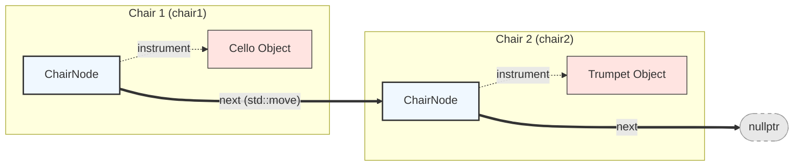

# Activity: Building the Polymorphic Orchestra (45 Minutes)

**Goal:** Transform `Instrument` into an abstract base class, utilize intermediate access modifiers, derive specific instruments with their own unique variables, design the smart-pointer `ChairNode`, and manually link them together.

**Prerequisites:** Students have the `instrument.h` file containing private member variables, a parameterized constructor, and a virtual destructor. They have had introductory lectures on smart pointers and inheritance but need practical implementation.

## Part 1: The Blueprint & Data Access (8 Minutes)

### 👨‍🏫 Instructor Overview (3 mins)

* **The Blueprint Problem:** Pose a design flaw to the class: *"Right now, a programmer can instantiate a generic `Instrument` in `main()`. But in the real world, you can't play a 'generic instrument.' What C++ feature do we use to force a class to act strictly as a blueprint?"* Guide them to the concept of an abstract base class and pure virtual functions.

* **The Access Problem:** Next, point out a data access issue: *"If we derive a `Cello` class, the Cello will inherit the `name` variable. But because `name` is `private`, the Cello isn't allowed to touch it directly. What access modifier sits between `public` and `private` that allows family access but keeps data hidden from the outside world?"*

### 📝 Student Task (5 mins)

**Task:** Open your `instrument.h` file and make two architectural updates:

1. **Family Access:** Find your member variables (name, manufacturer, etc.) at the top of the file. Change their access modifier to the keyword that allows derived classes to access them directly, while keeping them hidden from `main()`.

2. **The Blueprint:** Locate the `Utility Methods` section. Declare a pure virtual function named `play` that returns `void` and does not modify the object state (`const`).

### 🛑 Solution Code & Concept Breakdown (For Instructor)

Share this annotated code with students to explain *why* these keywords matter:

```cpp
class Instrument {
    
    // THE PROTECTED MODIFIER
    // 'protected' acts as the perfect middle ground. It keeps this data securely 
    // hidden from the outside world (main), but grants direct "family access" 
    // to any child classes we derive from it. Because of this, a Cello 
    // can just type `name` instead of `getName()`.
    protected: 
        string name = "";
        string manufacturer = "";
        int yearBuilt = 1970;
        int cost = 0;
        
    public:
        // THE VIRTUAL KEYWORD
        // 'virtual' tells C++ to look at the actual object in memory at runtime, 
        // not just the pointer type. Here, it guarantees that if a ChairNode 
        // destroys an Instrument, it correctly runs the Cello or Trumpet 
        // destructor first, preventing memory leaks.
        virtual ~Instrument() = default;

        // PURE VIRTUAL FUNCTION (= 0)
        // The '= 0' means this base class provides no implementation.
        // It transforms Instrument into an Abstract Base Class (a strict blueprint)
        // and forces every child class to write their own version of play().
        virtual void play() const = 0; 
};
```

## Part 2: The Specific Children (12 Minutes)

### 👨‍🏫 Instructor Overview (4 mins)

* **Constructor Chaining:** Ask the class: *"If a Cello is an Instrument, it needs a name and a year built. But the Cello class didn't declare those variables—the base class did. How do we pass initialization data from a child's constructor up to the parent's constructor?"* Briefly review the concept of a member initialization list.

* **The Contract:** Remind them that because `play()` is now a pure virtual function, they have signed a contract. Ask: *"What keyword should we put at the end of our child's `play()` function to ask the compiler to double-check that we fulfilled the contract correctly?"*

### 📝 Student Task (8 mins)

**Task:** Create a new file (or add to your `.cpp`). You have four instruments to choose from:

* **Cello** (New variable: `string bowType` | Prints: *"Drawing the \[bowType\] bow across..."*)
* **Trumpet** (New variable: `string finish` | Prints: *"Buzzing the mouthpiece of the \[finish\] trumpet..."*)
* **Flute** (New variable: `string material` | Prints: *"Blowing across the \[material\] embouchure hole..."*)
* **SnareDrum** (New variable: `string stickType` | Prints: *"Striking the batter head with \[stickType\] sticks..."*)

Choose **two** of these instruments. For each:

1. Inherit from `Instrument`.
2. Add the new `private` member variable to the child class.
3. Write a constructor that accepts **5** variables (the 4 base ones + the 1 new one). Chain the 4 base variables to `Instrument`, and initialize the 1 new variable in the child.
4. Override the `play()` function. Use the inherited `name` variable and your **new** member variable directly in the `cout` statement.

### 🛑 Solution Code & Concept Breakdown (For Instructor)

Walk the students through the `Cello` implementation step-by-step:

```cpp
class Cello : public Instrument 
{
private:
    string bowType; 

public:
    Cello(string nm, string manuf, int yearBlt, int cst, string bowType)
        : Instrument(nm, manuf, yearBlt, cst), bowType(bowType) {}

    void play() const override 
    {
        cout << name << " (Cello): Drawing the " << bowType << " bow across the strings...\n";
    }
};
```

**Post-Task Breakdown to share with students:**

1. **Inheritance Syntax (`: public Instrument`):** The colon establishes the "Is-A" relationship. We must use `public` so `main()` knows a Cello is an Instrument, which enables polymorphism. *(Note: If we used `private` inheritance, it would be a secret relationship, completely breaking our ability to put it in an Orchestra!)*
2. **Constructor Chaining (`: Instrument(...)`):** The second colon begins the initialization list. We take the first four arguments and pass them directly up to the parent class to initialize the base data, then initialize our own `bowType` locally.
3. **Fulfilling the Contract (`override`):** This keyword is a safety net. It asks the compiler to verify we perfectly matched the parent's virtual function signature.
4. **The `const` Promise (Read-Only):** Placing `const` at the end promises the compiler this function will only read data, never change it. Playing an instrument doesn't magically alter its `cost` or `name`!

## Part 3: Anatomy of a ChairNode (10 Minutes)

### 👨‍🏫 Instructor Overview (5 mins)

* **The Stage Metaphor:** Draw a stage setup on the board. An array is like a fixed set of bleachers. A linked list is a row of independent **Chairs** placed on the stage. Each Chair holds two things: the **Data** (the instrument sitting in it) and the **Link** (a pointer to the next chair). To make this clear in our code, we will name our structure `ChairNode`.
* **Polymorphism in the Chair:** Pose the problem: *"If we build a Chair specifically to hold a Cello, we can't sit a Flute in it. How do we design a single universal Chair that can hold ANY instrument?"* (Guide them to realize the data type must be a smart pointer to the base class).
* **Struct vs. Class:** Ask the students: *"A `ChairNode` is simply a lightweight data container that we need direct access to. Should we use a `class` or a `struct` for this, and what is the default access difference between the two?"*
* **Modern Ownership:** Ask how we prevent memory leaks when a chair is removed. Guide them to `std::unique_ptr` and strict ownership.

### 📝 Student Task (5 mins)

**Task:** Define the `ChairNode` structure.

1. Include the `<memory>` header.
2. Define a `struct` named `ChairNode`.
3. Give it two member variables: a `unique_ptr` to an `Instrument`, and a `unique_ptr` to the next `ChairNode`.
4. Write a constructor that takes an instrument `unique_ptr`. Use `std::move()` in the initializer list to transfer ownership into the node, and set the next pointer to `nullptr`.

### 🛑 Solution Code & Concept Breakdown (For Instructor)

```cpp
#include <memory>

struct ChairNode {
    std::unique_ptr<Instrument> instrument; 
    std::unique_ptr<ChairNode> next;        

    ChairNode(std::unique_ptr<Instrument> inst) 
        : instrument(std::move(inst)), next(nullptr) {}
};
```

**Post-Task Breakdown to share with students:**

1. **The Lightweight Container (`struct`):** A struct defaults to `public`. Because a node is just a plain data container meant to be accessed directly by our list manager, making it a `struct` saves us from writing tedious getter/setter methods.
2. **Strict Ownership (`unique_ptr`):** "Unique" means exclusive ownership. This specific Chair exclusively owns the Instrument in it, and exclusively owns the Next Chair. No sharing allowed, which prevents memory crashes.
3. **The Hand-Off (`std::move`):** Because `unique_ptr` guarantees exclusive ownership, C++ completely disables copy-pasting for them. `std::move(inst)` tells the compiler: *"Take the memory owned by `inst`, and permanently transfer ownership over to the `instrument` member variable."* The temporary `inst` variable is left totally empty.

## Part 4: The Manual Stage Setup (10 Minutes)

### 👨‍🏫 Instructor Overview (3 mins)

* **The Proof of Concept:** We have the pieces, but no Manager (Orchestra) to organize them yet. Ask the class: *"Can we manually put two chairs on the stage, put instruments in them, and link them together by hand to prove this works?"*
* **Visualizing the Manual Link:** Show students the following diagram of what they are about to build in memory. Emphasize that the first chair entirely owns the second chair!



* **The Hitch:** Remind them that `unique_ptr` cannot be copied. If they want to attach Chair 2 to Chair 1's `next` pointer, they must explicitly transfer ownership using `std::move()`.
* **The `auto` Keyword:** Tell them they will explicitly write out `std::unique_ptr<ChairNode>` for the first chair so they see the actual type, but they can use `auto` for the second chair to see how C++ deduces it automatically.

### 📝 Student Task (7 mins)

**Task:** Write the `main()` function to manually build a tiny linked list of two chairs.

1. Create a `ChairNode` using `std::make_unique`. Inside that, construct your first instrument (e.g., your Cello). Save this as `chair1`, and explicitly write out its full `std::unique_ptr` type.
2. Create a second `ChairNode` containing your second instrument. Save this as `chair2`, but this time use the `auto` keyword to let the compiler figure out the type.
3. Manually link them: Set `chair1`'s `next` pointer to own `chair2`. (Hint: use `std::move()`).
4. Prove polymorphism works: Call `play()` on `chair1`'s instrument, and then call `play()` on the instrument sitting in `chair1`'s `next` chair!

### 🛑 Solution Code (For Instructor)

```cpp
int main() {
    // 1. Setup the first chair and sit a Cello in it.
    // We explicitly write out the type so we know exactly what is happening under the hood.
    std::unique_ptr<ChairNode> chair1 = std::make_unique<ChairNode>(
        std::make_unique<Cello>("Stradivarius", "Antonio Stradivari", 1711, 2500000, "French")
    );

    // 2. Setup the second chair and sit a Trumpet in it.
    // Here we use 'auto'. The compiler sees std::make_unique<ChairNode> and 
    // automatically translates 'auto' into 'std::unique_ptr<ChairNode>'.
    auto chair2 = std::make_unique<ChairNode>(
        std::make_unique<Trumpet>("Model 37", "Vincent Bach", 2015, 3000, "Silver")
    );

    // 3. Link them together: Chair 1 now owns Chair 2
    chair1->next = std::move(chair2);

    // 4. Play them manually to prove the polymorphic dispatch works
    cout << "\n=== Manual Concert ===\n";
    chair1->instrument->play();
    chair1->next->instrument->play();
    
    return 0; // Both chairs and instruments are automatically destroyed here!
}
```

## Part 5: Looking Ahead - The Orchestra (5 Minutes)

### 👨‍🏫 Instructor Conceptual Wrap-up (No Coding)

* **The Problem with Manual Linking:** Ask the students: *"That was tedious. Imagine doing that for a 100-piece orchestra. What happens if you need to insert a French Horn between Chair 1 and Chair 2?"* (Acknowledge that manual linking scales terribly).
* **The Conductor:** Next lecture, we will build the `Orchestra` class to automate this. This class acts as the **Conductor**. The Conductor doesn't memorize where every single musician sits; they only hold a pointer to the **First Chair** (`head`).
* **The Smart Pointer Chain Reaction:** Leave them with a thought experiment: *"Look at your `main()` function. You never wrote `delete`. When `chair1` goes out of scope, it deletes itself. But because `chair1` owns `chair2`, what happens to `chair2`? What if `chair1` owned a chain of 1,000 chairs?"* (They should understand this will trigger a cascading, automatic cleanup of the entire stage!).